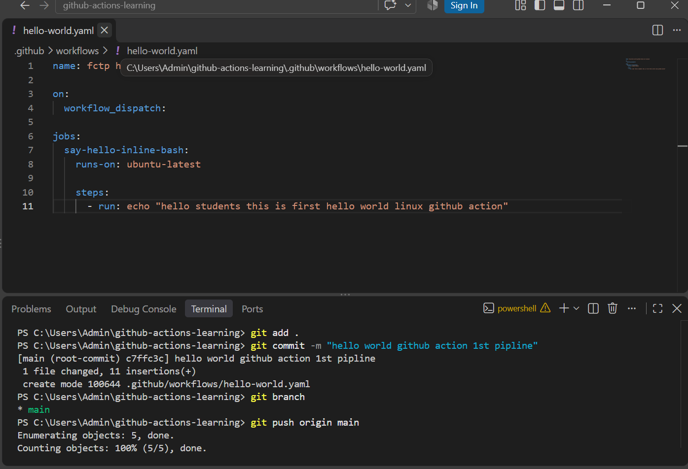
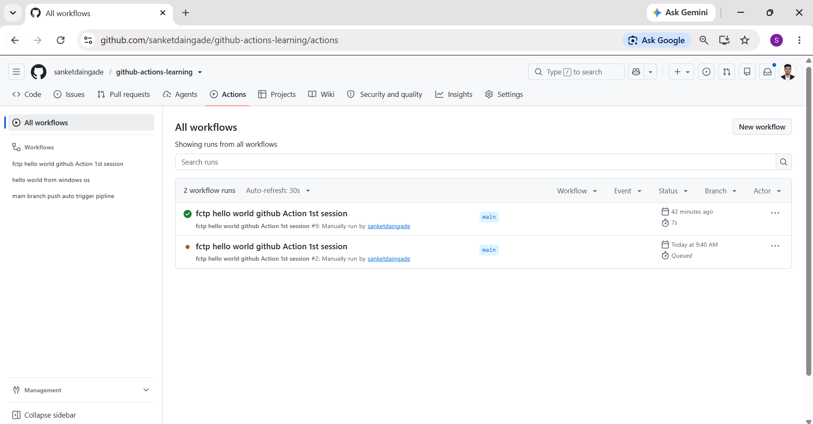
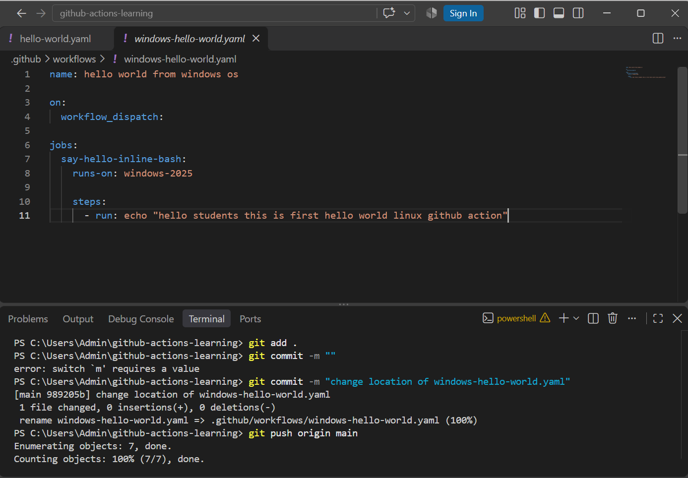
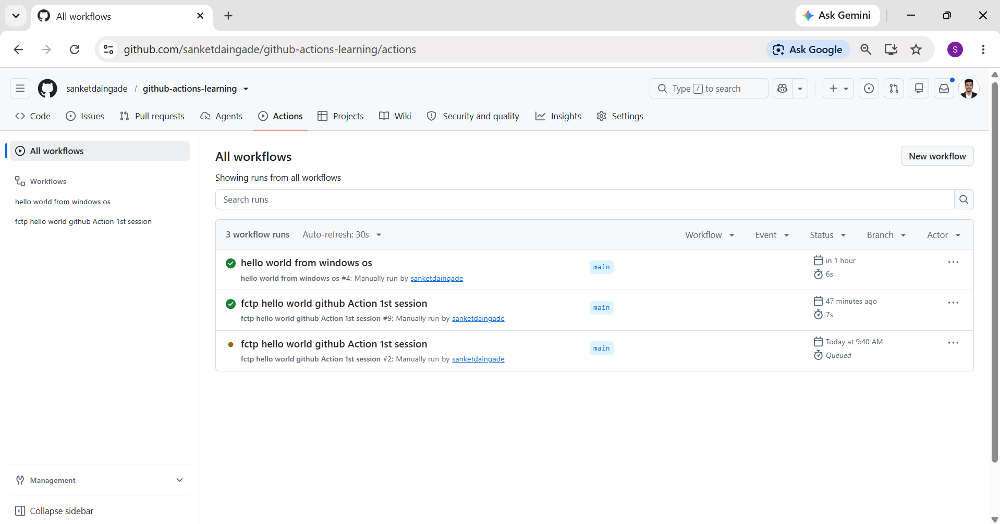
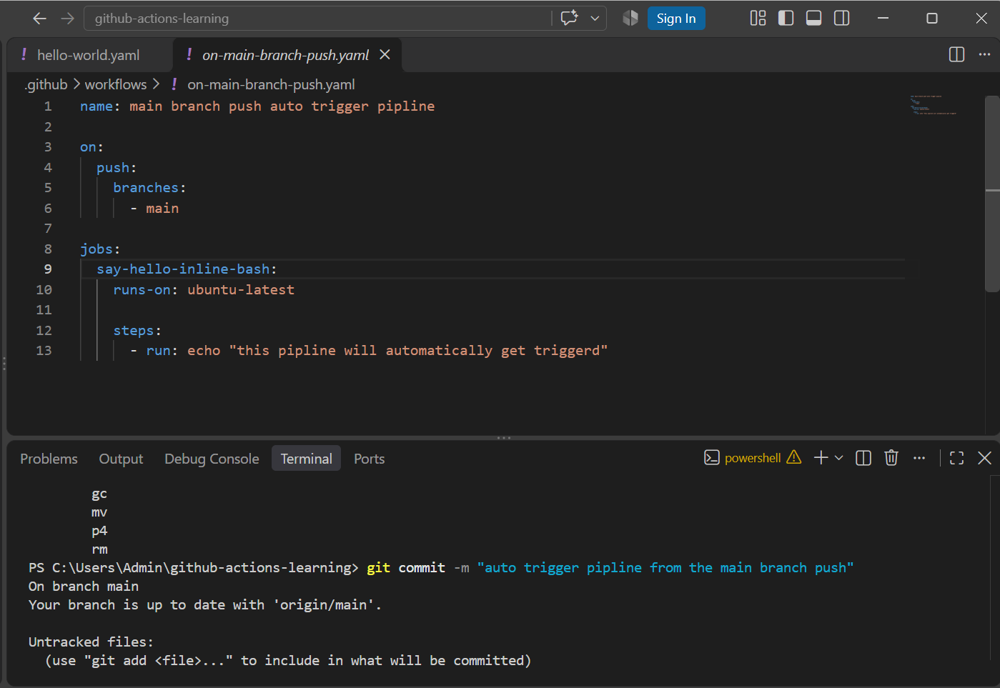
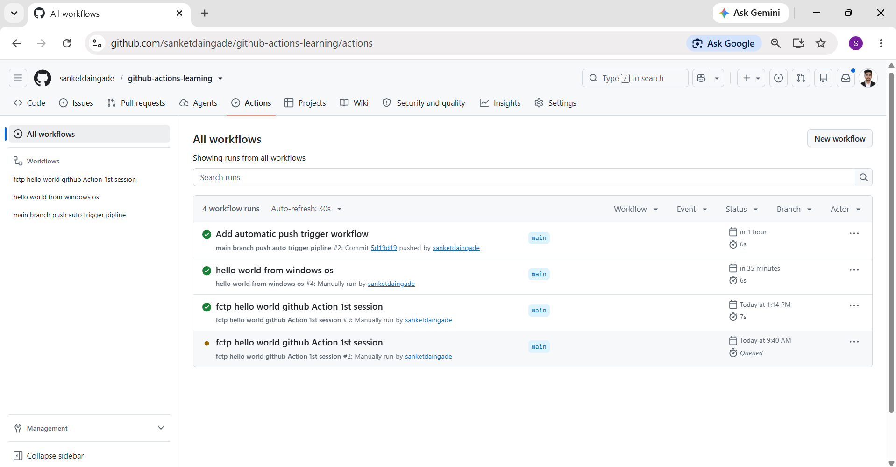

# GitHub Actions Learning

This repository contains my hands-on practice with GitHub Actions. I created different workflows to understand manual execution, different operating systems, and automatic workflow triggers.

## What is GitHub Actions?

GitHub Actions is a CI/CD automation platform that helps automate software development workflows directly from GitHub repositories.

## Practical 1: Ubuntu Hello World

* **Workflow:** `hello-world.yaml`
* **Runner:** `ubuntu-latest`
* **Trigger:** Manual trigger using `workflow_dispatch`
* **Task:** Execute a simple Hello World message using a Bash command.

### Workflow Code

### Successful Execution

## Practical 2: Windows Hello World

* **Workflow:** `windows-hello-world.yaml`
* **Runner:** `windows-2025`
* **Trigger:** Manual trigger using `workflow_dispatch`
* **Task:** Execute a simple Hello World message on a Windows runner.

### Workflow Code

### Successful Execution

## Practical 3: Automatic Workflow Trigger on Main Branch Push

* **Workflow:** `on-main-branch-push.yaml`
* **Runner:** `ubuntu-latest`
* **Trigger:** Automatic trigger using the `push` event.
* **Branch:** `main`
* **Task:** Automatically execute the workflow whenever new changes are pushed to the main branch.

### Workflow Code

### Successful Execution

## Technologies Used

* Git
* GitHub
* GitHub Actions
* YAML
* Ubuntu
* Windows Runner
* Bash

## Key Learnings

* Created and executed GitHub Actions workflows.
* Understood manual workflow execution using `workflow_dispatch`.
* Practiced workflows on Ubuntu and Windows runners.
* Configured automatic workflow execution using the `push` event.
* Understood basic CI/CD automation concepts.

## Repository Owner

**Sanket Daingade**

* GitHub: [sanketdaingade](https://github.com/sanketdaingade)
* LinkedIn: [Sanket Daingade](https://www.linkedin.com/in/sanketdaingade/)
